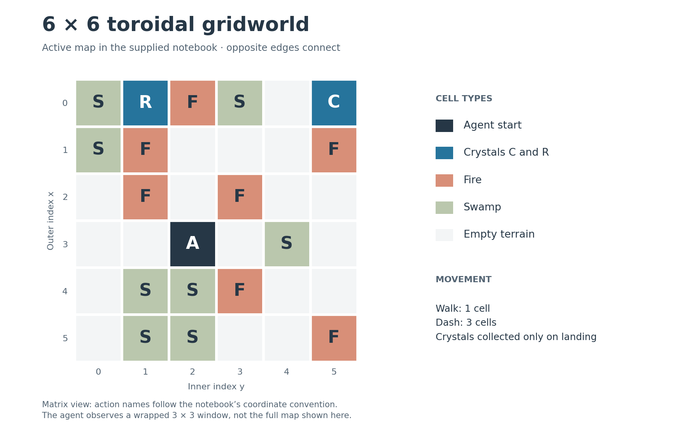
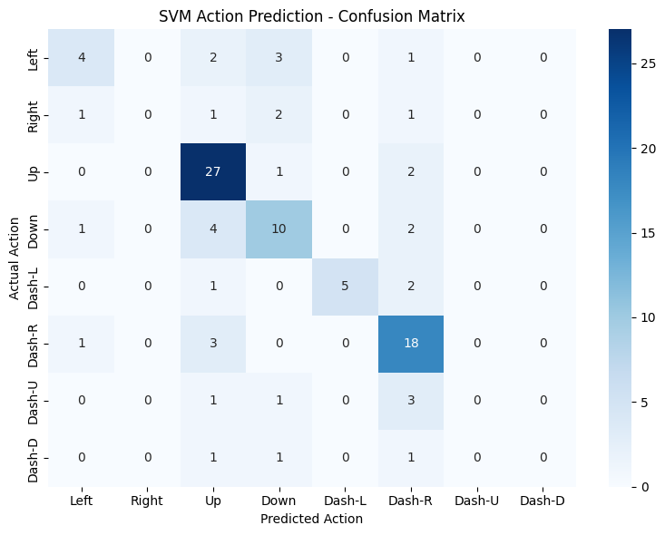

# DQN Gridworld: Reward Shaping and Exploration

A PyTorch reinforcement-learning project exploring how movement costs, sparse goals, and local reward shaping affect navigation. A Deep Q-Network controls an agent in a custom gridworld with wraparound boundaries, fire, swamp, and three-cell dash actions. An RBF SVM then examines how well a small replay buffer captures the agent's action choices.

The project extends an **MMA 606 course-provided assignment workflow**. Its contribution is the environment changes, network experiments, reward design, and analysis of successful and failed runs.

**Explore:** [notebook](notebooks/dqn_gridworld.ipynb) · [experiment notes](docs/experiment_notes.md) · [environment tests](tests/test_environment.py)



## What is implemented

- **Custom environment:** a 6×6 toroidal map with two crystals, hazardous fire cells, and costly swamp terrain.
- **Local observations:** a wrapped 3×3 window, encoded over six cell types into 54 inputs.
- **Eight actions:** four one-cell moves and four three-cell dashes. Dashes inspect intermediate hazards, but collect crystals only on landing.
- **DQN:** a `54 → 256 → 128 → 8` network, experience replay, a target network, and epsilon-greedy exploration.
- **Beacon reward:** a per-step bonus based on toroidal Manhattan distance to the nearest remaining crystal.
- **Action prediction:** an RBF SVM fitted to the latest 100 replay-buffer transitions, with class-level diagnostics.

The custom environment is implemented directly in Python; it does not depend on Gymnasium.

## Results and their scope

The report follows several iterations: expanding a 5×5 map to 6×6, changing network width and depth, opening routes through terrain, and increasing the beacon reward. The strongest recorded result appears in the report; the final supplied notebook preserves a different, unsuccessful run.

| Evidence | Recorded result | Interpretation |
| --- | --- | --- |
| Report: stronger beacon reward | Return **1013** at the checkpoint labeled 145; final mean also 1013 | A reported successful run, not proof of an optimal route or reliable convergence |
| Final notebook: saved DQN run | Final mean **−33** | The saved 51-step trajectory collects one crystal and then cycles, leaving the second uncollected |
| SVM action prediction | **64% accuracy**, macro F1 **0.41**, on 100 examples | Training-set score: the same replay-buffer states are used for fitting and prediction |

The report screenshot and notebook log are retained separately so their provenance is clear: [reported success](assets/report/beacon_multiplier_2.png), [saved notebook training log](assets/notebook/training_log.txt), and [saved trajectory](assets/notebook/trajectory.txt). Replaying the saved actions checks the environment's behavior; it does not reproduce the trained policy.

Reward design is central to this case study, but the iterations are not a controlled ablation. Maps, architectures, and rewards change across trials, and there is no repeated-seed study. Shaped returns also include extra bonuses, so they are not directly comparable with earlier returns under a different reward function.

### What the SVM reveals



Up and Dash-R account for 52 of the 100 recorded labels. Right, Dash-U, and Dash-D receive no predictions in the saved matrix. Always predicting the most common action would score 30% on this sample; uniform random prediction has nominal accuracy 12.5%. These are sample-specific references, not evidence of generalization or a comparison with the DQN's navigation return.

## Run locally

Python 3.11 is the version used for the publication checks. A CPU is sufficient for the notebook's implemented workflow; no cloud account, credentials, or external dataset is required.

```bash
git clone https://github.com/LokiLJ/dqn-gridworld-reward-shaping.git
cd dqn-gridworld-reward-shaping
python -m pip install -r requirements.txt
jupyter lab notebooks/dqn_gridworld.ipynb
```

Run from a fresh kernel in cell order. Training has a maximum of 200 episodes and may stop early at the specified reward threshold. Run the SVM cells after training has populated the replay buffer. Random seeds are not fixed in the original experiment, so a new run can differ substantially from the saved examples.

Run the environment checks without training:

```bash
python -m unittest discover -s tests -v
```

`requirements.txt` is a dependency inventory, not the original environment lockfile. The source did not preserve dependency versions or a trained checkpoint.

## Implementation details that affect interpretation

The portfolio notebook retains the submitted environment, reward function, and learning settings. It also documents several behaviors that matter for future experiments:

- Landing on swamp overwrites that terrain with the agent, and leaving clears the cell. The beacon bonus is also applied on terminal fire steps.
- A proximity bonus can reward repeated movement near a goal; it is not a potential-difference shaping rule with a policy-invariance guarantee.
- The target network starts independently initialized and is synchronized every 20 completed episodes.
- Training caps episodes at 50 steps, while evaluation permits 51. Printed checkpoint labels are one greater than the completed-episode counter in that training call.
- Final evaluation repeats the same map and start position with a greedy policy. It is not testing on 20 unseen environments.

See the [experiment notes](docs/experiment_notes.md) for exact rewards, hyperparameters, source discrepancies, and the publication cleanup. Full training was not rerun for this release.

## Repository layout

```text
.
├── README.md
├── .gitignore
├── requirements.txt
├── notebooks/dqn_gridworld.ipynb
├── docs/experiment_notes.md
├── tests/test_environment.py
└── assets/
    ├── gridworld_map.png
    ├── notebook/                  # Saved text outputs from the supplied notebook
    └── report/                    # Original figures extracted from the report
```

## Origin and attribution

This project originated from an **MMA 606 course assignment**. The DQN notebook was adapted from the **course-provided starter workflow**, rather than authored entirely from scratch. This edition uses the extended `MMA_606_Assignment_3_Notebook.ipynb` and the accompanying `Assignment.docx` as its factual basis. Source files remain unchanged; course directions and local runtime metadata were removed from the public copy.

For background on the methods, see the [official PyTorch DQN tutorial](https://docs.pytorch.org/tutorials/intermediate/reinforcement_q_learning.html) and [scikit-learn's evaluation guidance](https://scikit-learn.org/stable/modules/cross_validation.html). These are learning references, not claimed sources of the course starter code.
